# Jenkins CI/CD with Rolling and Blue-Green Deployments


**Exercise date:** brief released 7 September 2026 | **Type:** Davine Technologies Internship Project, DevOps internship week 9 lab | **Status:** rebuilt as tested code; run live with Amazon ECR, verified and destroyed on 17 November 2026

[](https://github.com/ooseni/davine-week9-jenkins-cicd-deployments/actions/workflows/ci.yml)

> **Evaluation project.** A learning task completed for the Davine Technologies internship programme, rebuilt for this repository. Jenkins and the Kubernetes cluster ran on my own machine, and the container registry in my own AWS account, only for the length of a test run. It is not a production setup and contains no company code or data.

**At a glance**

- **Outcome:** a commit to GitHub becomes a tested, scanned release running on Kubernetes with no one touching Jenkins. A broken release is caught and rolled back on its own before users notice. Both rolling and blue-green deployments work.
- **Built:**
  - a declarative [`Jenkinsfile`](Jenkinsfile) from checkout to rollback, for week 7's web app rebuilt from source;
  - Jenkins itself as code (Configuration as Code, 69 pinned plugins);
  - Terraform for an Amazon ECR repository and a push-only IAM role;
  - rolling and blue-green manifests with a least-privilege deployer and a default-deny network policy;
  - deploy, verify and rollback scripts tested end to end in CI;
  - a [report](docs/report.md) ([PDF](docs/report.pdf)), an [implementation guide](docs/implementation.md) and an [AI assistant log](docs/ai-cicd-assistant.md).
- **Stack:** Jenkins 2.580.2 LTS (JCasC, Job DSL, declarative pipeline), Docker 29 with BuildKit, Python 3.14 (Flask, gunicorn, pytest, ruff), Kubernetes 1.36 (k3s on k3d 5.9, kustomize), Amazon ECR, AWS IAM, Terraform 1.17 (AWS provider 6.73), GitHub Actions, Bash, hadolint, kubeconform, ShellCheck, TFLint, Checkov, Trivy, gitleaks.
- **Proof:** on 17 November 2026 Jenkins ran 11 builds of this repository and pushed 10 images to Amazon ECR.
  - A commit of release 1.1.0 rolled out with **0 of 287 requests failing**.
  - A deliberately broken release failed fast after 55 seconds and was rolled back, with **0 of 297 requests failing**.
  - Live verification passed **22 of 22**, then everything was destroyed.
  - On every push, CI runs 38 app tests, 13 Terraform tests, 17 Jenkins checks and a 25-check end-to-end test on a real cluster.

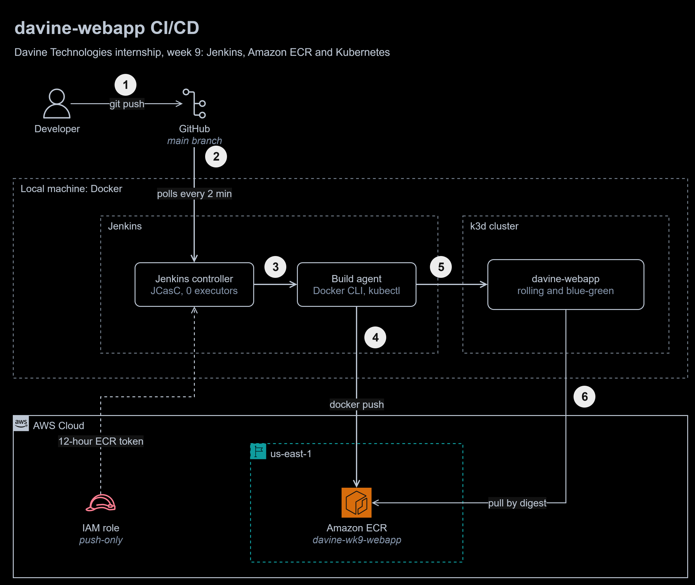

To zoom in, right-click the diagram and open the image in a new tab. The editable source is [`docs/diagrams/pipeline-architecture.drawio`](docs/diagrams/pipeline-architecture.drawio).

1. A **developer** pushes a commit to `main` on **GitHub**.
2. The **Jenkins controller** polls GitHub every two minutes, sees the commit and starts the pipeline. It runs no builds itself (0 executors).
3. The **build agent** checks the code out, builds it, runs the tests and static checks in parallel, and builds and smoke-tests the Docker image.
4. The agent pushes the image to **Amazon ECR** with a 12-hour token. The token comes from an **IAM role** that can push to this one repository only, so Jenkins holds no AWS key.
5. The agent deploys to the **k3d cluster** as `jenkins-deployer`, an account limited to one namespace, with a rolling update or a blue-green switch.
6. The cluster pulls the image **by digest** from ECR. The pipeline verifies the release, and rolls it back if it never becomes ready or fails verification.

## The task, in my own words

Learn how a CI/CD pipeline takes code from a commit to a running release, and why each stage exists. Then, hands on:

- run Jenkins and connect it to a GitHub repository;
- write the pipeline as a `Jenkinsfile` with Checkout, Build, Test and Package stages;
- use environment variables, and add an automated test stage;
- build a Docker image in the pipeline and push it to a container registry;
- study blue-green and rolling deployments.

Then, as the DevOps engineer for a team that releases often and wants less downtime:

- take the application from the previous weeks;
- build, test and package it automatically;
- release a new version with a rolling deployment and check that it is running;
- break a release on purpose, and roll back to the last working version;
- document the whole flow, with a pipeline architecture diagram, screenshots and a short report.

Finally, use an AI assistant to write and explain Jenkinsfiles, read console logs, write tests and review the pipeline.

## What I did in the internship, and what this repository is

The brief for this week was released on 7 September 2026. I completed it in the internship and submitted the work to the programme. I did not keep copies, so for this repository I rebuilt the week as code, tested it, and ran it again on 17 November 2026. Every transcript and screenshot here comes from that run, and the commit dates are the real dates of this rebuild.

## How it builds on weeks 5 to 8

| Week | What it left | What this week does with it |
|---|---|---|
| [5: Jenkins](https://github.com/ooseni/davine-week5-jenkins) | Build and Test stages that only `echo`; builds on the controller (`agent any`); a webhook through an ngrok tunnel; Jenkins set up by hand | real stages with JUnit results; a separate agent, 0 executors on the controller; Jenkins polls GitHub, so nothing is exposed; Jenkins defined as code |
| [6: Terraform and Ansible](https://github.com/ooseni/davine-week6-IAc) | infrastructure as code on AWS | Terraform for the registry and a push-only IAM role, with 13 tests against a mocked provider |
| [7: Kubernetes](https://github.com/ooseni/davine-week7-kubernetes-containers-orc) | `davine-webapp` in `davine-space` on NodePort 30080, rolled out and back by hand; no probes; the version kept in a ConfigMap | the same names and port, now the pipeline's job; probes, resource limits, `maxUnavailable: 0`; the version baked into the image; the ConfigMap rolls back with the code |
| [8: Monitoring](https://github.com/ooseni/davine-week8-Monitoring-Logging-Observability) | Prometheus and Grafana watching a host | the app serves Prometheus metrics; the Verify stage reads `build_info` to confirm which release answers |

It also leads into the [capstone](https://github.com/ooseni/ai-ecommerce-devops), whose Jenkins pipeline deploys to k3d and then AWS.

## The rebuilt solution

| Path | What it holds |
|---|---|
| [`Jenkinsfile`](Jenkinsfile) | the pipeline: Checkout, Build, Test (unit tests and static checks in parallel), Package, Push, Deploy, Verify, Rollback |
| [`app/`](app) | the web app (Flask on gunicorn), its 38 tests, and the three-stage [`Dockerfile`](app/Dockerfile) |
| [`jenkins/`](jenkins) | the controller ([Configuration as Code](jenkins/controller/casc/jenkins.yaml), [pinned plugins](jenkins/controller/plugins.txt)), the agent, and the [compose file](jenkins/compose.yaml) |
| [`k8s/`](k8s) | [`cluster`](k8s/cluster) (namespace, deployer account, network policy), [`rolling`](k8s/rolling) and [`blue-green`](k8s/blue-green) |
| [`terraform/`](terraform) | the ECR repository and the push-only role, and [13 tests](terraform/tests/registry.tftest.hcl) |
| [`scripts/`](scripts) | deploy, verify, rollback and blue-green, which the pipeline calls; start-up, live verification and teardown |
| [`tests/`](tests) | the end-to-end, Jenkins and redaction tests |
| [`docs/`](docs) | [report](docs/report.md), [implementation](docs/implementation.md), [testing](docs/testing.md), [AI assistant](docs/ai-cicd-assistant.md), [diagrams](docs/diagrams), [live transcripts](docs/evidence) |
| [`screenshots/`](screenshots) | redacted Jenkins, AWS console and app screenshots from the live run |

**What the brief asked for, and where it is:**

| Brief | Done by | Evidence |
|---|---|---|
| Set up Jenkins | controller and agent in Docker, configured as code | [nodes](screenshots/08-jenkins-nodes.png) |
| Connect Jenkins with GitHub | the job reads `Jenkinsfile` from `main` and polls every two minutes | [build #4, started by an SCM change](screenshots/02-pipeline-stages-release-1.1.0-build-4.png) |
| A pipeline in a Jenkinsfile, with Checkout, Build, Test and Package | [`Jenkinsfile`](Jenkinsfile) | [stage graph](screenshots/02-pipeline-stages-release-1.1.0-build-4.png) |
| Build a Docker image and push it to a registry | Package and Push stages, to Amazon ECR | [ECR images](screenshots/09-ecr-images-unique-immutable-tags.png), [scan](screenshots/10b-ecr-scan-findings.png) |
| Environment variables | `environment` block, values computed per build, global values from Configuration as Code | [report §5](docs/report.md#5-build-automation-and-environment-variables) |
| An automated test stage | 38 pytest tests, reported to Jenkins as JUnit | [test report](screenshots/04-unit-tests-38-passing.png) |
| Study blue-green and rolling | both built and run; compared in the report | [report §9 to §11](docs/report.md#9-rolling-deployment), [blue-green build](screenshots/07-pipeline-stages-blue-green-build-5.png) |
| Use the application from previous weeks | week 7's `davine-webapp`, rebuilt from source | [the app](screenshots/12-app-rolling-release-1.1.0.png) |
| Deploy a new version with a rolling update, and verify it | release 1.1.0, build #4 | [deploy log: 287 requests, 0 failed](screenshots/03-deploy-log-rolling-update-287-requests-0-failed.png) |
| A controlled deployment issue | `SIMULATE_BAD_RELEASE`: `ENV_MODE=prod`, which the app refuses | [the app's own error](screenshots/05a-bad-release-deploy-log-refusing-to-start.png) |
| Roll back to the previous version | the Rollback stage | [stage graph](screenshots/05b-bad-release-stages-rollback.png), [rollback log](screenshots/06e-bad-release-console-rollback-to-revision-3.png) |
| Pipeline architecture diagram | [`pipeline-architecture.drawio`](docs/diagrams/pipeline-architecture.drawio), [`pipeline-stages.drawio`](docs/diagrams/pipeline-stages.drawio) | above, and below |
| A short PDF report and an implementation summary | [report.pdf](docs/report.pdf), [implementation.md](docs/implementation.md#summary) | |
| AI as a CI/CD assistant | what it did, and what checking changed | [ai-cicd-assistant.md](docs/ai-cicd-assistant.md) |

### The pipeline

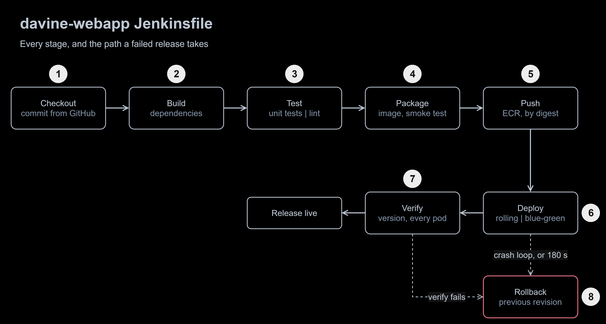

The editable source is [`docs/diagrams/pipeline-stages.drawio`](docs/diagrams/pipeline-stages.drawio).

1. **Checkout** fetches the commit and names the build `#N version (commit)`.
2. **Build** installs the hash-pinned dependencies in the Dockerfile's build stage, and builds its test stage.
3. **Test** runs pytest in the test image, in parallel with ruff, hadolint and kubeconform.
4. **Package** builds the runtime image (non-root, read-only) and smoke-tests it, including that it refuses a bad setting.
5. **Push** sends it to Amazon ECR with a unique, immutable tag, and records its digest.
6. **Deploy** releases that digest with a rolling update, or to the idle blue-green slot and then switches. A traffic probe counts failed requests throughout.
7. **Verify** checks the version, the metrics and every pod's image.
8. **Rollback** runs only if Deploy or Verify failed: it returns to the recorded revision, or switches blue-green back, and verifies again. The build is then marked failed.

### Decisions

- **Jenkins polls instead of receiving a webhook,** so nothing on the machine is reachable from the internet. Week 5 needed an ngrok tunnel.
- **Jenkins holds no AWS key.** It gets a 12-hour ECR token minted through a role that can push and pull one repository.
- **The cluster runs digests, not tags,** and ECR tags are immutable, so what was tested is what runs.
- **Configuration rolls back with the code:** the ConfigMap's name carries a hash of its content.
- **A broken release is caught fast and judged fairly:** the deploy stops as soon as a new pod crash-loops, and fails if more than 1% of requests fail during the change.

The full reasoning, including what the live run changed, is in [docs/implementation.md](docs/implementation.md#decisions).

### Running it

```bash
aws sso login --profile <admin-profile> && export AWS_PROFILE=<admin-profile>
terraform -chdir=terraform init && terraform -chdir=terraform apply   # ECR repository and push role
scripts/cluster_up.sh                                                # k3d cluster, namespace, deployer
scripts/jenkins_up.sh                                                # Jenkins, with an ECR token
scripts/jenkins_build.sh                                             # first release; later commits release themselves
scripts/jenkins_build.sh rolling true                                # rehearse a bad release and its rollback
scripts/verify_live.sh && scripts/teardown.sh                        # check, then remove everything
```

Without AWS: `scripts/cluster_up.sh --registry`, then `scripts/jenkins_up.sh --local`. Every step is explained in [docs/implementation.md](docs/implementation.md).

## How it is tested

**Tested on every push** by GitHub Actions, with no AWS credentials, in three jobs:

- **Checks:**
  - **38 of 38** app tests pass, with 100% coverage;
  - ruff, hadolint and ShellCheck report no issues;
  - kubeconform validates all 15 rendered Kubernetes resources;
  - **17 of 17** redaction cases pass;
  - **13 of 13** Terraform tests pass against a mocked provider, and TFLint reports nothing;
  - Checkov and Trivy pass, with every skip and ignore given a written reason;
  - gitleaks finds no secrets in the history.
- **Jenkins:** the controller image boots from its configuration, and **17 of 17** checks pass, covering security, the agent, the job, the polling trigger, the credentials and all 69 plugins. Jenkins' own linter accepts the Jenkinsfile and rejects a broken copy.
- **End to end:** on a real k3d cluster, **25 of 25** checks pass. They cover:
  - a rolling update under traffic;
  - a bad release and its rollback;
  - a blue-green switch and switch back;
  - a bad blue-green release that never reaches users;
  - a network policy that blocks outbound traffic.

To prove the tests catch real mistakes, I broke copies of the code seven ways: mutable tags, scanning off, `ecr:*` on the push role, trust opened to anyone, a mistyped setting accepted, a security header dropped, and unlimited metrics labels. Each break failed at least one test.

**Tested live** on 17 November 2026, with 11 Jenkins builds:

- **Commits released themselves:** five builds were started by commits through polling.
- **A rolling release of 1.1.0 lost nothing:** 0 of 287 requests failed during it.
- **Blue-green switched cleanly:** 0 of 35 requests failed during the switch.
- **Two deliberately bad releases were contained,** one rolling and one blue-green. Each failed fast (55 s and 46 s) and was rolled back, and no user request failed.
- **The live verification passed 22 of 22:**
  - the repository settings;
  - all 10 image scans;
  - a refused attempt to move a tag;
  - the push role's limits, tested by acting as it and with IAM's policy simulator;
  - the cluster running ECR digests;
  - the build history.

Two builds failed for reasons the live run taught me (see Mistakes), and one I aborted while the machine was overloaded. The build-by-build record is in [docs/testing.md](docs/testing.md#live-17-november-2026-jenkins-amazon-ecr-in-us-east-1-k3d).

## Screenshots

From the 17 November 2026 run, with the AWS account ID, account name and browser profile picture blacked out.

**A commit released by the pipeline.** Build #4 was started by an SCM change, and every stage passed. Rollback was skipped.

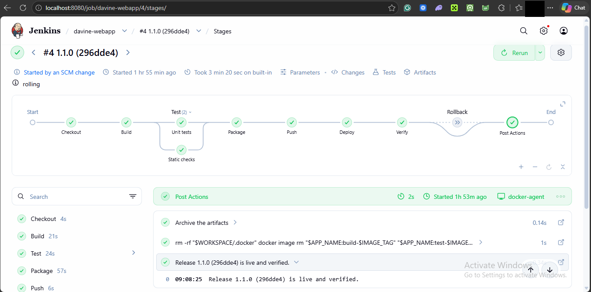

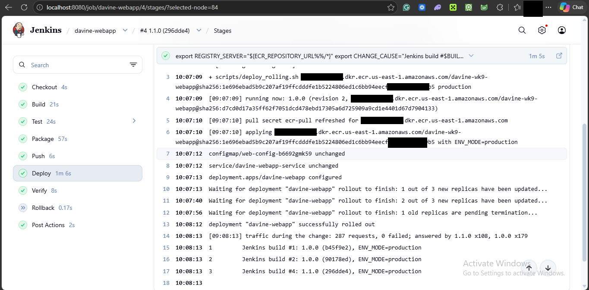

**A bad release, caught and rolled back.** In build #6, Deploy failed, Verify was skipped, and Rollback ran.

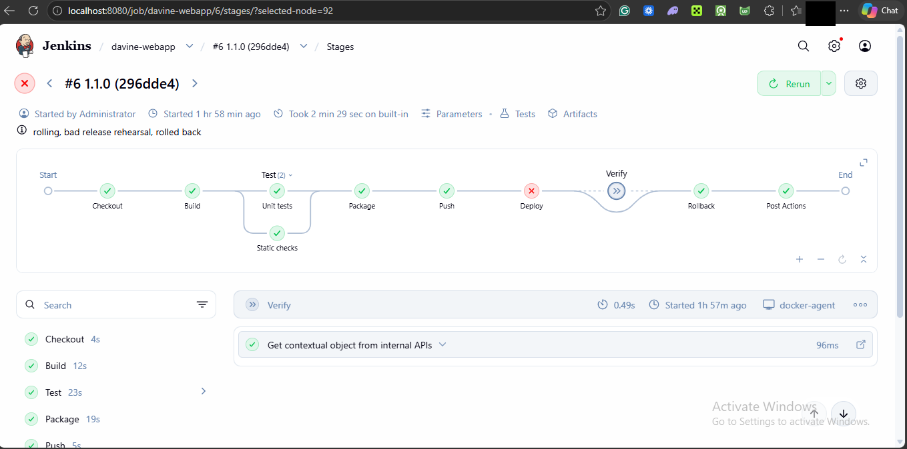

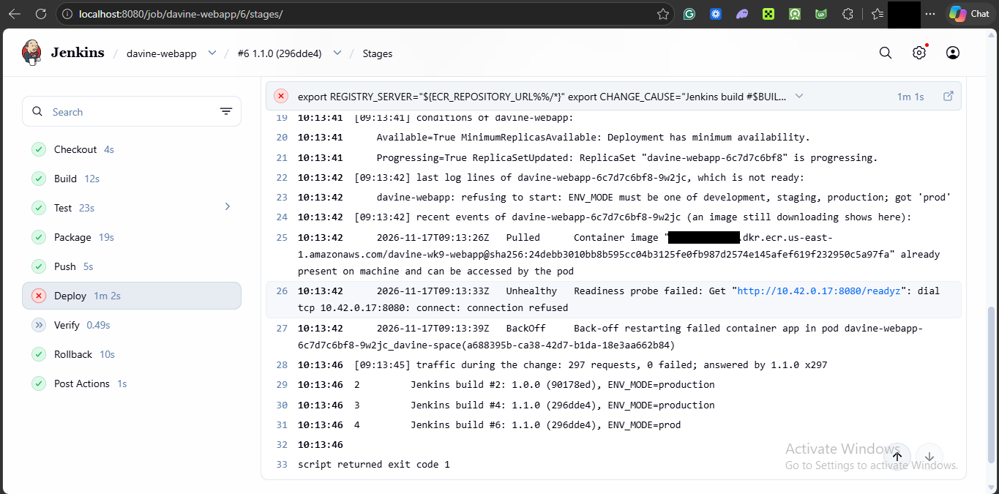

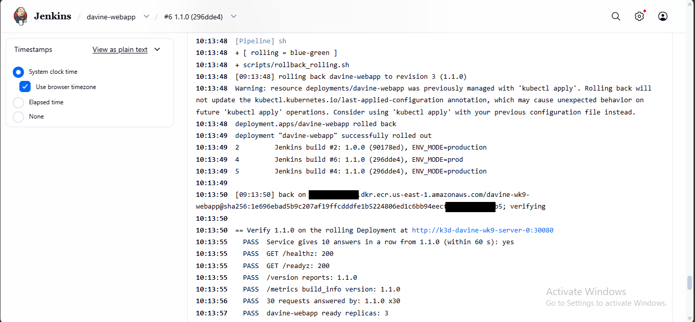

**The registry and the role.**

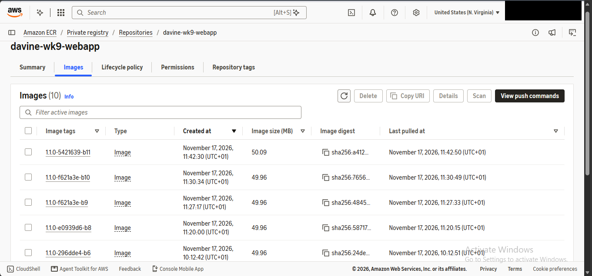

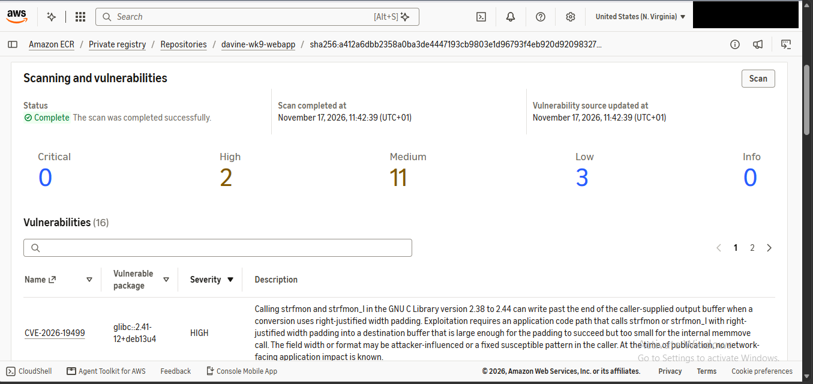

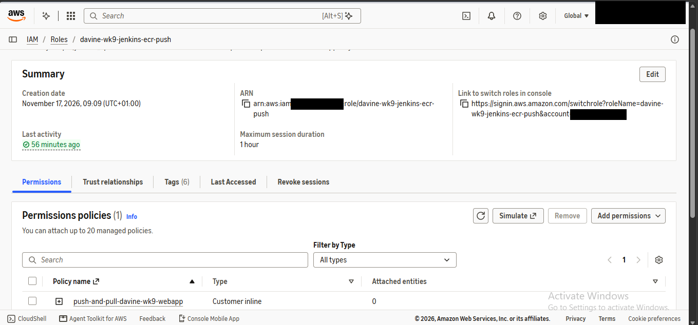

**The app**, release 1.1.0, naming the pod that answered:

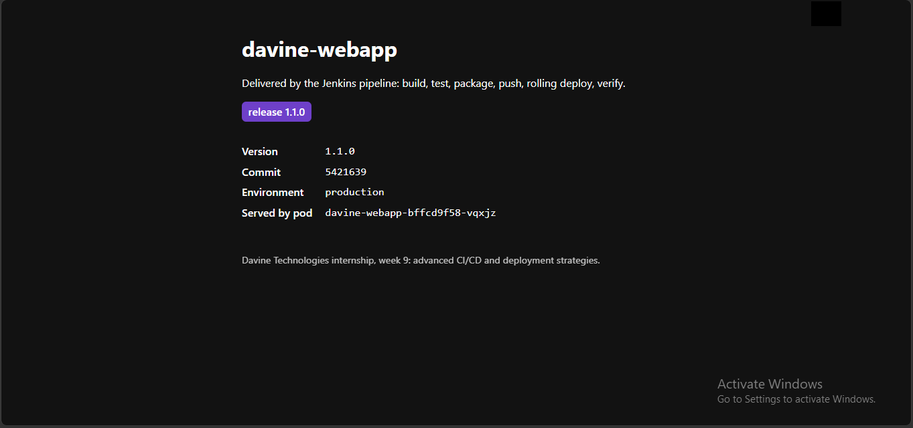

**Also:**

- the build history: [durations](screenshots/01a-jenkins-build-history-and-durations.png), [descriptions](screenshots/01b-jenkins-build-history-descriptions.png), [first builds](screenshots/01c-jenkins-build-history-first-builds.png);
- the [unit tests](screenshots/04-unit-tests-38-passing.png), the [Jenkins nodes](screenshots/08-jenkins-nodes.png) and the [blue-green build](screenshots/07-pipeline-stages-blue-green-build-5.png);
- build #6's console, step by step: [package](screenshots/06a-bad-release-console-package.png), [fail fast](screenshots/06b-bad-release-console-fail-fast.png), [pod log and events](screenshots/06c-bad-release-console-pod-log-and-events.png), [deploy failed](screenshots/06d-bad-release-console-deploy-failed.png), [verify after rollback](screenshots/06f-bad-release-console-verify-after-rollback.png), [finished](screenshots/06g-bad-release-console-finished.png);
- the [ECR image details](screenshots/10a-ecr-image-details.png) and the [blue-green live slot](screenshots/13-app-blue-green-live-slot.png).

## Mistakes I fixed

1. **A deadline a slow download could beat.** Build #1 failed a good release: the 50 MB image took 1 min 39 s to pull from ECR, and Kubernetes counts that against `progressDeadlineSeconds`, which was 60 s. The deadline is now 180 s, and the deploy script fails fast when a new pod crash-loops, so a broken release is still caught in under a minute.
2. **A gate with zero tolerance.** In build #8, one request timed out on the busy machine before the deployment had changed anything, and the pipeline rolled back a good release. The gate is now an error budget: more than 1% failed requests fails the deploy, and every failure is still reported.
3. **Polling that stopped after a restart.** Configuration as Code regenerates the job at every start, which dropped the trigger only the Jenkinsfile had set, so a pushed commit sat unbuilt for 11 minutes. The trigger is in the job definition too now, and the Jenkins test checks it.
4. **101 zombie processes on the agent.** The agent image runs Java as process 1, which never reaps orphaned processes. It now runs under an init, and the count stayed at 0.
5. **Known vulnerabilities in the image.** ECR's scan found 3 HIGH, 12 MEDIUM and 3 LOW findings, all in Debian packages of the base image. The runtime stage now applies Debian's security updates: 2 HIGH, 11 MEDIUM, 3 LOW. The two HIGH left are in glibc, which has no fixed version yet.
6. **Probes that killed healthy pods.** In the first end-to-end run, pods requested 25m of CPU and probes used the 1-second default timeout. On a busy host a healthy pod answered slowly and was restarted in the middle of a blue-green switch. Pods now request 100m, and probes allow 3 seconds.
7. **Blue-green slots that never got manifest changes.** My first version created the slots once and then changed them with `kubectl set image`, so later manifest changes, like fix 6, would never have reached them. Each release now applies an overlay containing only the idle slot.
8. **A check that read the wrong field.** My live verification first reported 0 of 9 image scans complete. The scans had run: `describe-images` no longer returns scan results, so the script now reads each image's findings separately.

## Traps I avoided

- **A ConfigMap edited in place does not roll back.** It is not part of the Deployment's history, so `rollout undo` would bring back the old image with the new, broken settings. The ConfigMap's name carries a hash of its content instead.
- **`rollout undo` with no revision can go one release too far** when the failed deploy never created a revision. The rollback returns to the revision number recorded before the deploy.
- **A tag can be moved to different bytes.** The pipeline deploys by digest, and ECR refuses to move a tag (`ImageTagAlreadyExistsException`, tested live).
- **The ECR repository URL contains the account ID.** It reaches Jenkins as a global variable from Configuration as Code, never through git.
- **An ECR token outlives the role session that minted it.** I tested it: a token from a one-hour session still worked after the session ended. So the token is guarded as the 12-hour secret it is, stored as a Jenkins credential and masked in every log.
- **A failed stage skips everything after it.** Deploy and Verify run inside `catchError`, so the build is marked failed while the Rollback stage still runs.

## Lab vs production

| Concern | In this lab | Before going to production | Well-Architected pillar |
|---|---|---|---|
| Where builds run | one long-lived agent container using the host's Docker socket, which is root-equivalent on the machine | ephemeral agents per build (Kubernetes pods), images built rootless (BuildKit) without a host socket | Security |
| Registry credentials | a 12-hour ECR token from a push-only role, minted from my own session | an EC2 instance profile or an IAM role for the agent's service account, so no human mints tokens | Security |
| Trigger | Jenkins polls GitHub every two minutes | a webhook to a Jenkins reachable only from GitHub's published address ranges, with the webhook secret checked | Operational Excellence |
| Cluster | one k3d node on a laptop | Amazon EKS across availability zones, with the nodes pulling from ECR through their own role | Reliability |
| Releases | rolling and blue-green by script; a rollback is `rollout undo` | GitOps (Argo CD or Flux) with progressive delivery (Argo Rollouts) and automated analysis of metrics before promotion | Reliability |
| Image trust | ECR basic scanning on push; 2 glibc HIGH findings with no fix yet, accepted for the lab | Amazon Inspector enhanced scanning, signed images, an admission policy that runs only signed images from ECR, and a written exception for any accepted finding | Security |
| Encryption keys | ECR's AWS managed KMS key | a customer managed key with rotation and an audited key policy | Security |
| Jenkins state | a Docker volume on one machine | configuration as code (already) plus backups of build history, or a stateless controller | Reliability |
| Cost | everything removed the same day; old images expire after the newest 10 | the same lifecycle policy, plus budgets and cost allocation tags | Cost Optimization |
| Capacity | 3 pods at 100m CPU each, sized to fit a laptop shared with another cluster | sized from measured load, with a HorizontalPodAutoscaler | Performance Efficiency |
| Footprint | one small node, removed after use | right-sized nodes on Graviton, scaled to zero out of hours where possible | Sustainability |

## What I learned

- **A pipeline is only as safe as its rollback,** and the rollback path needs testing as much as the release path. Here it is a stage that runs, verifies and fails the build loudly.
- **Readiness probes and `maxUnavailable: 0` make a bad release harmless.** The old pods kept serving through both bad releases; the pipeline only had to notice and undo.
- **A gate needs a budget, not perfection.** A gate that fails on one stray timeout teaches people to ignore it.
- **Configuration as code helps only if it captures everything.** A trigger that lived only in the Jenkinsfile vanished at every restart.
- **Least privilege works for CI too.** A short-lived token from a narrow role replaced an access key, and a deployer that cannot touch other namespaces replaced cluster-admin.
- **Run it for real.** Five of the problems above appeared only against a real registry, on a real, busy machine.

## Sources

[Jenkins Pipeline syntax](https://www.jenkins.io/doc/book/pipeline/syntax/), [Jenkins Configuration as Code](https://www.jenkins.io/projects/jcasc/), [Kubernetes Deployments](https://kubernetes.io/docs/concepts/workloads/controllers/deployment/), [Liveness, readiness and startup probes](https://kubernetes.io/docs/concepts/configuration/liveness-readiness-startup-probes/), [Amazon ECR image tag mutability](https://docs.aws.amazon.com/AmazonECR/latest/userguide/image-tag-mutability.html), [Amazon ECR image scanning](https://docs.aws.amazon.com/AmazonECR/latest/userguide/image-scanning.html), [Amazon ECR registry authentication](https://docs.aws.amazon.com/AmazonECR/latest/userguide/registry_auth.html), [Blue/Green Deployments on AWS](https://docs.aws.amazon.com/whitepapers/latest/blue-green-deployments/welcome.html).

## License

Released under the [MIT License](LICENSE). The Davine Technologies course material is not included.
